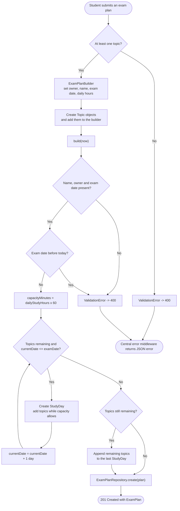
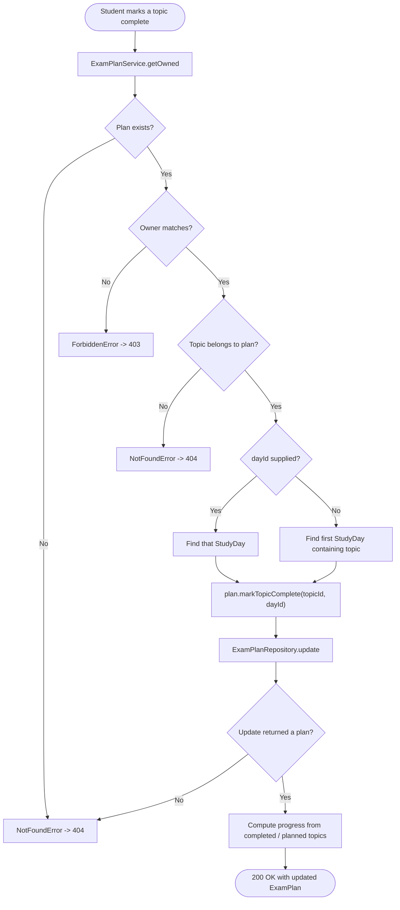

# Activity Diagram: Exam Plan

## Create an exam plan

`POST /api/exam-plans` validates the request with Zod, then `ExamPlanService` uses
`ExamPlanBuilder` to distribute topics across calendar days up to the exam date. A single topic
may exceed the daily capacity; the builder keeps at least one topic per day and appends any
overflow to the final study day.

## Mark a topic complete

`POST /api/exam-plans/:id/topics/:topicId/complete` can receive an optional `dayId`. When it is
omitted, the plan marks the topic on the first study day that contains it.

## Notes

- If the requested `dayId` does not contain the topic, `markTopicComplete()` returns `false`
  and the plan is saved unchanged.
- `ExamPlan.getProgress()` uses the distinct planned topic IDs, falling back to the plan's topic
  list when no study days exist, so completion percentage stays stable across reschedules.
- When an exam date or daily study hours change, `ExamPlanService.update()` rebuilds the study
  days and then restores previously completed topics.
