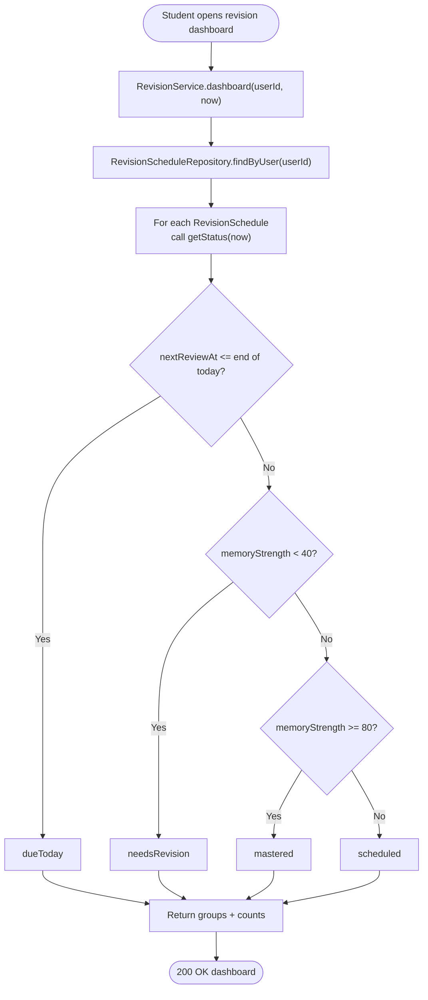
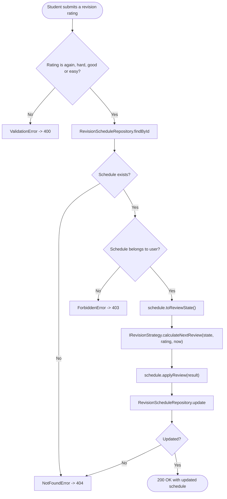
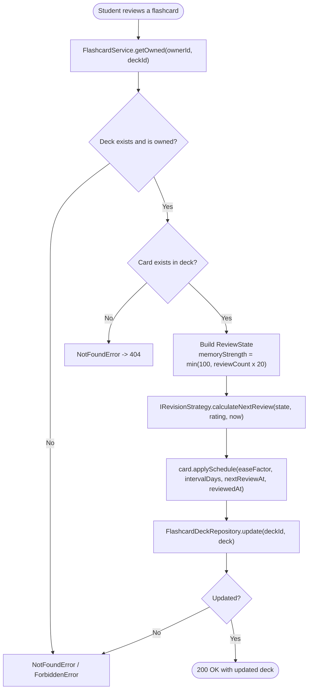

# Activity Diagram: Revision Mode

## Load the revision dashboard

`GET /api/revision/dashboard` groups every schedule for the current user by
`RevisionSchedule.getStatus()`. Due status wins over memory strength, then weak and mastered
topics are separated by score.

## Review a due topic

`POST /api/revision/:id/review` accepts `again`, `hard`, `good` or `easy`. The service applies
the configured `IRevisionStrategy`, then persists the updated schedule.

## Review a flashcard

Flashcards use the same strategy abstraction but keep their scheduling state inside the owned
`Flashcard` object.

## Notes

- `RevisionService` also reacts to `QuizCompletedEvent`: it maps quiz percentage to a rating,
  calculates the next review, and creates or updates the topic schedule automatically.
- The dashboard returns four groups plus counts: `dueToday`, `needsRevision`, `mastered` and
  `scheduled`.
- Topic schedules and flashcards share the configured strategy (`SM2Strategy` by default, or
  `SimpleMemoryStrengthStrategy` when `REVISION_STRATEGY=simple`).
