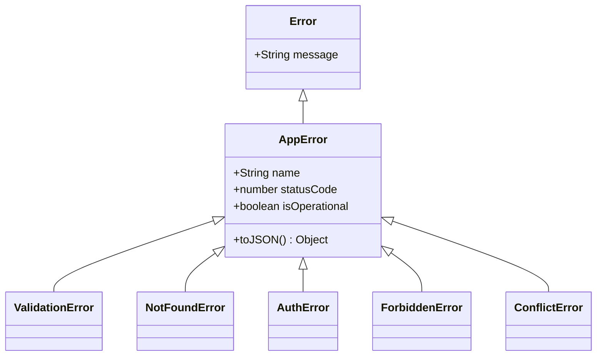

# Class Diagram

The class diagram is split into three views so that the domain model, the pattern/infrastructure
collaborations and the error hierarchy stay readable.

Notation:

- `+` public, `-` private, `#` protected.
- `*` marks an abstract member.
- `$` marks a static member where shown.
- `--` association, `o--` aggregation, `*--` composition, `<|--` inheritance and `<|..`
  interface realization.

## 1. Domain model

```mermaid
classDiagram
    direction TB

    class User {
        -String _id
        -String _name
        -String _email
        -String _passwordHash
        +User(props)
        +getId() String
        +getName() String
        +setName(name) void
        +getEmail() String
        +setPasswordHash(hash) void
        +verifyPassword(candidate, compare) Promise
        +toJSON() Object
    }

    class StudyItem {
        <<abstract>>
        -String _id
        -String _title
        -String _ownerId
        -String _shareToken
        +StudyItem(props)
        +getId() String
        +getTitle() String
        +setTitle(title) void
        +getOwnerId() String
        +makeShareable(token) void
        +revokeSharing() void
        +isShared() boolean
        +summary()*
        +itemType*
    }

    class IShareable {
        <<interface>>
        +getShareToken() String
        +makeShareable(token) void
        +revokeSharing() void
        +isShared() boolean
    }

    class Note {
        -String _spaceId
        -String _content
        -String _aiSummary
        -List _tags
        +Note(props)
        +getContent() String
        +setContent(content) void
        +setAiSummary(summary) void
        +summary() String
    }

    class Quiz {
        -String _spaceId
        -String _description
        -List _questions
        -number _timeLimitMinutes
        +Quiz(props)
        +getQuestions() List
        +setQuestions(questions) void
        +addQuestion(question) void
        +grade(answers) QuizGradeResult
        +getMaxScore() number
        +summary() String
    }

    class IGradable {
        <<interface>>
        +grade(answers) QuizGradeResult
        +getMaxScore() number
    }

    class FlashcardDeck {
        -String _spaceId
        -String _description
        -List _cards
        +FlashcardDeck(props)
        +getCards() List
        +setCards(cards) void
        +addCard(card) void
        +shuffle(random) List
        +summary() String
    }

    class Flashcard {
        -String _id
        -String _front
        -String _back
        -number _easeFactor
        -number _intervalDays
        -number _reviewCount
        +Flashcard(props)
        +getFront() String
        +getBack() String
        +getEaseFactor() number
        +applySchedule(easeFactor, intervalDays, nextReviewAt, reviewedAt) void
        +isDue(now) boolean
    }

    class Question {
        <<abstract>>
        -String _id
        -String _prompt
        -number _points
        -String _explanation
        +Question(props)
        +getId() String
        +getPoints() number
        +type*
        +evaluate(response)*
        +getCorrectAnswer()*
        #buildEvaluation(correct, correctAnswer) QuestionEvaluation
        #validateOptions(options) List
    }

    class MCQQuestion {
        -List _options
        -String _correctOptionId
        +MCQQuestion(props)
        +evaluate(response) QuestionEvaluation
        +getCorrectAnswer() List
    }

    class MultiSelectQuestion {
        -List _options
        -List _correctOptionIds
        +MultiSelectQuestion(props)
        +evaluate(response) QuestionEvaluation
        +getCorrectAnswer() List
    }

    class TrueFalseQuestion {
        -boolean _correctAnswer
        +TrueFalseQuestion(props)
        +evaluate(response) QuestionEvaluation
        +getCorrectAnswer() List
    }

    class QuizAttempt {
        -String _id
        -String _quizId
        -String _userId
        -List _answers
        -QuizGradeResult _result
        +QuizAttempt(props)
        +getQuizId() String
        +getUserId() String
        +getAnswers() List
        +getResult() QuizGradeResult
        +getPercentage() number
    }

    class StudySpace {
        -String _id
        -String _ownerId
        -String _name
        -String _subject
        -List _notes
        -List _quizzes
        -List _decks
        +StudySpace(props)
        +addNote(note) void
        +addQuiz(quiz) void
        +addDeck(deck) void
        +getNotes() List
        +getQuizzes() List
        +getDecks() List
        +summary() String
    }

    class ExamPlan {
        -String _id
        -String _name
        -String _ownerId
        -Date _examDate
        -number _dailyStudyHours
        -List _topics
        -List _studyDays
        +ExamPlan(props)
        +addTopic(topic) void
        +addStudyDay(day) void
        +markTopicComplete(topicId, dayId) boolean
        +getIncompleteTopicIds() List
        +getMissedWork(now) List
        +getPendingWork(now) List
        +moveTopics(fromDayId, targetDate, topicIds) void
        +getProgress() number
        +getDaysRemaining(now) number
    }

    class Topic {
        -String _id
        -String _name
        -String _description
        -number _estimatedMinutes
        +Topic(props)
        +getName() String
        +getEstimatedMinutes() number
    }

    class StudyDay {
        -String _id
        -Date _date
        -List _topicIds
        -List _completedTopicIds
        -number _plannedMinutes
        +StudyDay(props)
        +addTopic(topicId, estimatedMinutes) boolean
        +markTopicComplete(topicId) boolean
        +getIncompleteTopicIds() List
        +getProgress() number
        +isComplete() boolean
    }

    class AvailabilityWindow {
        -String _id
        -number _startMinutes
        -number _endMinutes
        +AvailabilityWindow(props)
        +getStartMinutes() number
        +getEndMinutes() number
        +getDurationMinutes() number
        +overlaps(other) boolean
    }

    class DayAvailability {
        -number _weekday
        -String _mode
        -number _budgetMinutes
        -List _windows
        -boolean _available
        +DayAvailability(props)
        +getWeekday() number
        +getMode() String
        +setMode(mode) void
        +getBudgetMinutes() number
        +setBudgetMinutes(minutes) void
        +isAvailable() boolean
        +setAvailable(available) void
        +getWindows() List
        +setWindows(windows) void
        +addWindow(window) void
        +removeWindow(windowId) boolean
        +getWindowMinutes() number
        +defaultFor(weekday)$ DayAvailability
    }

    class StudentAvailability {
        -String _id
        -String _userId
        -Map days
        +StudentAvailability(props)
        +getUserId() String
        +getDays() List
        +getDay(weekday) DayAvailability
        +setDay(day) void
        +defaultFor(userId)$ StudentAvailability
    }

    class CapacityCalculator {
        +forDay(day)$ DayCapacity
        +forDate(availability, date)$ DayCapacity
        +remainingForDate(availability, date, bookedMinutes)$ number
    }

    class Notification {
        -String _id
        -String _userId
        -String _type
        -String _title
        -String _message
        -boolean _read
        -String _dedupeKey
        -Date _createdAt
        +Notification(props)
        +getUserId() String
        +getType() String
        +getTitle() String
        +getMessage() String
        +isRead() boolean
        +markRead() void
        +getDedupeKey() String
    }

    class RevisionSchedule {
        -String _id
        -String _userId
        -String _topicId
        -String _topicName
        -number _memoryStrength
        -number _easeFactor
        -number _intervalDays
        -number _reviewCount
        -Date _nextReviewAt
        +RevisionSchedule(props)
        +toReviewState() ReviewState
        +applyReview(result) void
        +getStatus(now) RevisionStatus
        +isDue(now) boolean
    }

    class StudySession {
        -String _id
        -String _userId
        -String _spaceId
        -number _durationMinutes
        -Date _startedAt
        -Date _endedAt
        +StudySession(props)
        +complete(endedAt) void
        +isCompleted() boolean
    }

    class Bookmark {
        -String _id
        -String _userId
        -String _itemId
        -String _itemType
        +Bookmark(props)
        +getItemId() String
        +getItemType() String
    }

    class SharedLink {
        -String _id
        -String _token
        -String _itemId
        -String _itemType
        -String _ownerId
        -boolean _revoked
        +SharedLink(props)
        +isActive(now) boolean
        +revoke() void
    }

    StudyItem <|-- Note
    StudyItem <|-- Quiz
    StudyItem <|-- FlashcardDeck
    Question <|-- MCQQuestion
    Question <|-- MultiSelectQuestion
    Question <|-- TrueFalseQuestion
    IShareable <|.. StudyItem
    IGradable <|.. Quiz

    User "1" -- "0..*" StudySpace : owns
    User "1" -- "0..*" StudyItem : owns
    StudySpace "1" o-- "0..*" Note : aggregates
    StudySpace "1" o-- "0..*" Quiz : aggregates
    StudySpace "1" o-- "0..*" FlashcardDeck : aggregates
    Quiz "1" *-- "0..*" Question : owns
    FlashcardDeck "1" *-- "0..*" Flashcard : owns
    ExamPlan "1" o-- "0..*" Topic : aggregates
    ExamPlan "1" *-- "0..*" StudyDay : owns
    User "1" -- "0..*" ExamPlan : owns
    Quiz "1" -- "0..*" QuizAttempt : recorded as
    User "1" -- "0..*" QuizAttempt : takes
    User "1" -- "0..*" RevisionSchedule : follows
    RevisionSchedule "0..*" --> "1" Topic : references
    User "1" -- "0..*" StudySession : records
    StudySession "0..*" --> "0..1" StudySpace : optional context
    User "1" -- "0..*" Bookmark : saves
    Bookmark "0..*" --> "1" StudyItem : references
    User "1" -- "0..*" SharedLink : creates
    SharedLink "0..*" --> "1" StudyItem : exposes
    User "1" -- "0..1" StudentAvailability : sets
    StudentAvailability "1" o-- "7" DayAvailability : aggregates per weekday
    DayAvailability "1" *-- "0..*" AvailabilityWindow : owns
    User "1" -- "0..*" Notification : receives
    CapacityCalculator ..> DayAvailability : reads
    CapacityCalculator ..> StudentAvailability : reads
```

## 2. Patterns and infrastructure

```mermaid
classDiagram
    direction TB

    class IAIProvider {
        <<interface>>
        +String name
        +summarizeNote(input) Promise
        +generateQuiz(input) Promise
        +interpretCommand(input) Promise
    }

    class MockAIProvider {
        +String name
        +summarizeNote(input) Promise
        +generateQuiz(input) Promise
        +interpretCommand(input) Promise
    }

    class ExternalAIProvider {
        -String baseUrl
        -String apiKey
        +String name
        +summarizeNote(input) Promise
        +generateQuiz(input) Promise
        +interpretCommand(input) Promise
    }

    class IRevisionStrategy {
        <<interface>>
        +String name
        +calculateNextReview(state, rating, now) ReviewResult
    }

    class SimpleMemoryStrengthStrategy {
        +String name
        +calculateNextReview(state, rating, now) ReviewResult
    }

    class SM2Strategy {
        +String name
        +calculateNextReview(state, rating, now) ReviewResult
    }

    class IRescheduleStrategy {
        <<interface>>
        +String name
        +String label
        +propose(request) RescheduleSuggestion
    }

    class MoveToNextFreeSlotStrategy {
        +String name
        +String label
        +propose(request) RescheduleSuggestion
    }

    class MoveToWeekendStrategy {
        +String name
        +String label
        +propose(request) RescheduleSuggestion
    }

    class IObserver {
        <<interface>>
        +update(event) Promise
    }

    class EventBus {
        -Map listeners
        +subscribe(eventType, observer) void
        +unsubscribe(eventType, observer) void
        +publish(event) Promise
        +clear() void
        +getObserverCount(eventType) number
    }

    class AnalyticsService {
        -List recentQuizEvents
        +update(event) void
        +getOverview(userId, now) Promise
    }

    class RevisionService {
        +update(event) Promise
        +list(userId) Promise
        +dashboard(userId, now) Promise
        +review(userId, scheduleId, rating, now) Promise
    }

    class NotificationService {
        +update(event) Promise
        +list(userId) Promise
        +unreadCount(userId) Promise
        +markRead(userId, notificationId) Promise
    }

    class AvailabilityService {
        +getByUser(userId) Promise
        +saveWeek(userId, days) Promise
        +saveDay(userId, day) Promise
    }

    class AttentionService {
        +publishDetectedEvents(userId) Promise
        +report(userId) Promise
        +apply(userId, itemId, strategyName) Promise
        +applyToPlan(userId, planId, strategyName, now) Promise
        +previewMove(userId, planId, strategyName, now) Promise
    }

    class AssistantService {
        +propose(userId, text, now) Promise
        +apply(userId, planId, strategy, now) Promise
    }

    class FlashcardService {
        +reviewCard(ownerId, deckId, cardId, rating) Promise
    }

    class QuestionFactory {
        -Map creators$
        +create(input)$
        +register(type, creator)$
    }

    class StudyFacade {
        -StudyFacadeDependencies dependencies
        +condenseNote(note) Promise
        +generateQuizFromNote(note) Promise
        +gradeAndRecordAttempt(quiz, userId, answers) Promise
        +applyRevision(schedule, rating, now) RevisionSchedule
        +buildExamPlan(builder, now) ExamPlan
    }

    class ExamPlanBuilder {
        -String name
        -String ownerId
        -Date examDate
        -number dailyStudyHours
        -StudentAvailability availability
        -List topics
        +setName(name) ExamPlanBuilder
        +setOwnerId(ownerId) ExamPlanBuilder
        +setExamDate(examDate) ExamPlanBuilder
        +setDailyStudyHours(hours) ExamPlanBuilder
        +setAvailability(availability) ExamPlanBuilder
        +addTopic(topic) ExamPlanBuilder
        +setTopics(topics) ExamPlanBuilder
        +build(now) ExamPlan
    }

    class Question
    class Quiz
    class NoteService
    class QuizService
    class ExamPlanService

    class IRepository {
        <<interface>>
        +findById(id) Promise
        +findMany(filter) Promise
        +create(entity) Promise
        +update(id, entity) Promise
        +delete(id) Promise
        +exists(id) Promise
    }

    class BaseRepository {
        <<abstract>>
        #Model model
        #BaseRepository(model)
        #toDomain(document)*
        #toPersistence(entity)*
        +findById(id) Promise
        +findMany(filter) Promise
        +create(entity) Promise
        +update(id, entity) Promise
        +delete(id) Promise
        +exists(id) Promise
    }

    class UserRepository
    class NoteRepository
    class QuizRepository
    class QuizAttemptRepository
    class FlashcardDeckRepository
    class RevisionScheduleRepository
    class ExamPlanRepository
    class StudySpaceRepository
    class StudySessionRepository
    class SharedLinkRepository
    class BookmarkRepository
    class AvailabilityRepository
    class NotificationRepository

    class Config {
        -Config instance$
        -String _mongodbUri
        -String _jwtSecret
        -Config()
        +getInstance()$
        +mongodbUri String
    }

    class Database {
        -Database instance$
        -Connection connection
        -Database()
        +getInstance()$
        +connect(uri) Promise
        +disconnect() Promise
    }

    IAIProvider <|.. MockAIProvider
    IAIProvider <|.. ExternalAIProvider
    IRevisionStrategy <|.. SimpleMemoryStrengthStrategy
    IRevisionStrategy <|.. SM2Strategy
    IRescheduleStrategy <|.. MoveToNextFreeSlotStrategy
    IRescheduleStrategy <|.. MoveToWeekendStrategy
    IObserver <|.. AnalyticsService
    IObserver <|.. RevisionService
    IObserver <|.. NotificationService
    IRepository <|.. BaseRepository
    BaseRepository <|-- UserRepository
    BaseRepository <|-- NoteRepository
    BaseRepository <|-- QuizRepository
    BaseRepository <|-- QuizAttemptRepository
    BaseRepository <|-- FlashcardDeckRepository
    BaseRepository <|-- RevisionScheduleRepository
    BaseRepository <|-- ExamPlanRepository
    BaseRepository <|-- StudySpaceRepository
    BaseRepository <|-- StudySessionRepository
    BaseRepository <|-- SharedLinkRepository
    BaseRepository <|-- BookmarkRepository
    BaseRepository <|-- AvailabilityRepository
    BaseRepository <|-- NotificationRepository

    StudyFacade --> IAIProvider : uses
    StudyFacade --> IRevisionStrategy : uses
    StudyFacade --> EventBus : publishes
    StudyFacade ..> QuestionFactory : creates questions
    StudyFacade ..> Quiz : returns
    StudyFacade ..> ExamPlanBuilder : builds plan
    RevisionService --> IRevisionStrategy : delegates scheduling
    FlashcardService --> IRevisionStrategy : delegates scheduling
    EventBus o-- "0..*" IObserver : notifies
    QuestionFactory ..> Question : instantiates
    ExamPlanService --> ExamPlanBuilder : constructs
    ExamPlanService --> AvailabilityRepository : reads availability
    ExamPlanBuilder --> CapacityCalculator : caps daily capacity
    MoveToNextFreeSlotStrategy ..> CapacityCalculator : computes free minutes
    MoveToWeekendStrategy ..> CapacityCalculator : computes free minutes
    AttentionService --> IRescheduleStrategy : resolves suggestions
    AttentionService --> EventBus : publishes detected events
    AttentionService --> ExamPlanRepository : saves moved work
    AssistantService --> IAIProvider : interprets commands
    AssistantService --> AttentionService : previews and applies moves
    QuizService --> StudyFacade : delegates grading and generation
    NoteService --> StudyFacade : delegates AI work
```

## 3. Error hierarchy

`errorMiddleware` catches every `AppError` and serialises the same JSON shape:
`{ "error": { "name", "message", "details?" } }`.
