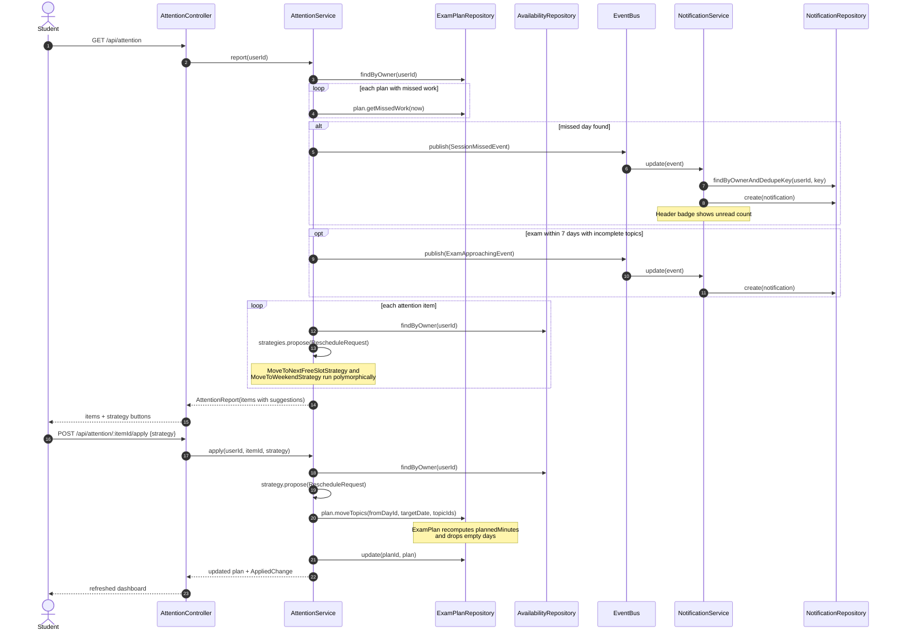

# Sequence: Missed Session → Notification → Adjustment

Shows how a missed study session becomes a notification in the app header and how the
student applies a reschedule suggestion from the "Needs attention" card. The same flow
powers the assistant command bar (`POST /api/assistant/command` → confirm → apply).

