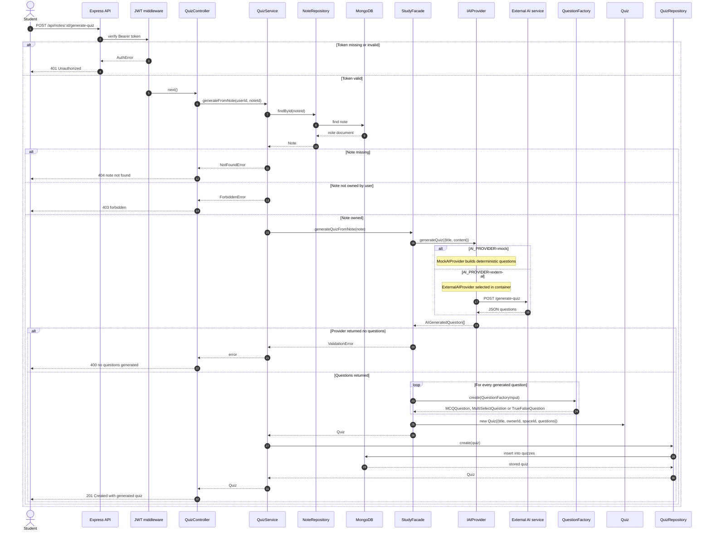

# Sequence Diagram: Generate a Quiz from a Note

This flow covers `POST /api/notes/:id/generate-quiz`. The AI provider is selected once in the
composition root from `AI_PROVIDER`; the service and facade depend only on `IAIProvider`.

## Notes

- `QuizService` validates ownership before calling the AI provider; generated content is never
  created on another user's note.
- `StudyFacade.toFactoryInput()` narrows the provider's discriminated question data and rejects
  incomplete MCQ, multi-select or true/false payloads with `ValidationError`.
- `QuestionFactory.create()` performs the polymorphic construction. `QuizService` and
  `StudyFacade` never instantiate a concrete question subtype directly.
- If the provider returns an empty array, the request fails before any quiz is persisted.
