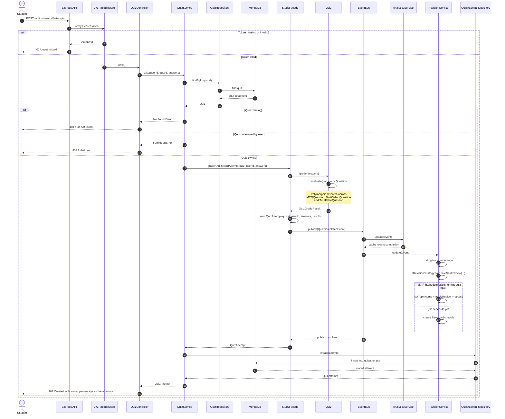

# Sequence Diagram: Take a Quiz

This flow covers `POST /api/quizzes/:id/attempts`. The public shared-quiz attempt path resolves
an active share token and calls `Quiz.grade()` directly: it returns feedback without storing an
attempt or publishing a domain event.

## Notes

- The event is published before `QuizAttemptRepository.create()` runs. Analytics caches the
  event, and `RevisionService` creates or updates the topic's revision schedule.
- `Quiz.grade()` never checks a question's concrete class. It calls the polymorphic
  `Question.evaluate()` method, so a new question subtype can be added without editing grading
  code.
- Ownership is checked before grading. The public quiz route instead resolves an active,
  non-revoked share token and calls `Quiz.grade()` directly; guests receive feedback but no
  `QuizAttempt` is persisted and no analytics/revision event is published.
