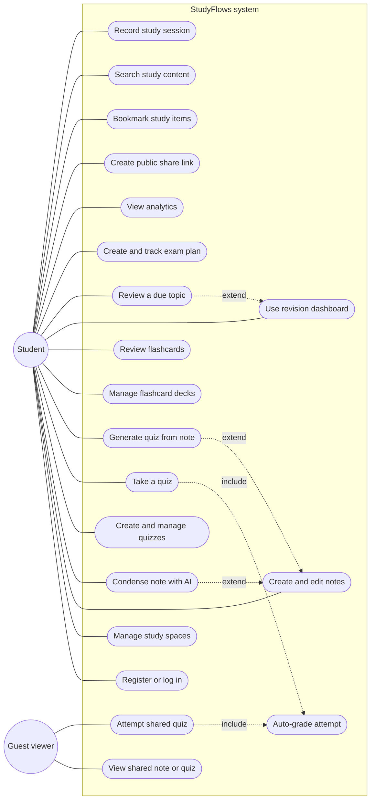

# Use Case Diagram

The two actors are the authenticated **Student** and the **Guest viewer** who opens a public
share link. All authenticated study features sit inside the StudyFlows system boundary. Guest
access is deliberately limited to reading a shared item and attempting a shared quiz.

## Notes

- **Include** relationships show behaviour that always happens as part of the base use case.
  Taking either an owned quiz or a shared quiz always runs the same grading workflow.
- **Extend** relationships show optional, AI-assisted or drill-down behaviour attached to a
  primary use case.
- `Condense` and `GenerateQuiz` use the configured `IAIProvider`, but the actor sees a single
  study action; provider selection is an internal implementation detail.
- The public share routes are the only study routes that do not require a JWT.
